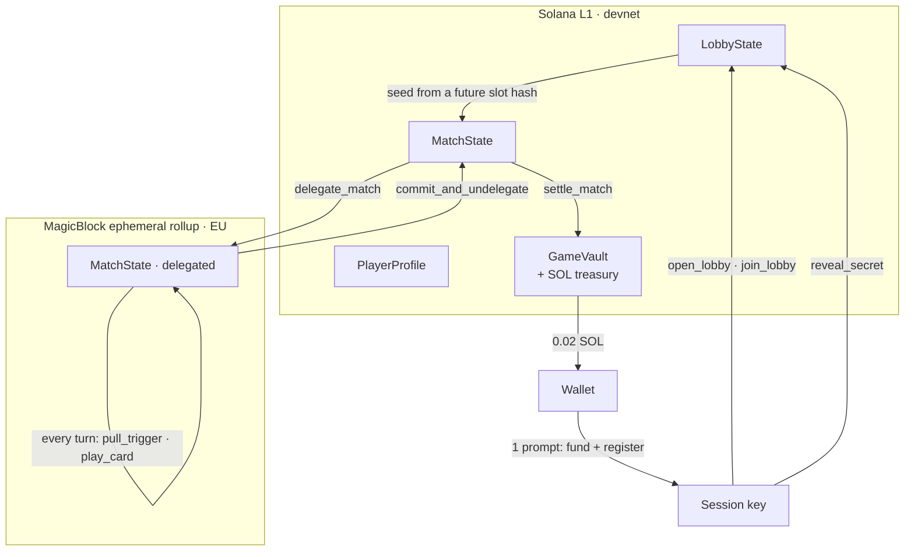

# ROLET — pitch deck

Three-minute pitch, seven slides (~25 s each). Speaker notes are what you say, not what is on screen.
Live demo: https://web-production-40a6c.up.railway.app · Code: https://github.com/SmtDcs/rolet

**Opening hook (first 15 seconds, say it before anything loads):**

> "Every web3 game I have played is a slot machine with a wallet. You press a button, the house rolls, and you find out what you were worth. I wanted to build the opposite: a game where the money is real and the outcome is yours."

---

## Slide 1 — The house always plays the same game

**Type:** hook / problem

- Play-to-earn died because the fun was never real: the draw was the token, not the game
- And when the draw *is* the draw — loot boxes, gacha, spin-to-win — skill has nowhere to sit
- Players can feel the difference between a game that rewards them and a game that harvests them

**Speaker notes:** Open on the hook above, then land one line: "That is a design failure, not a crypto problem." Pause. Do not explain the tech yet.

**Judging axes:** Product & market

---

## Slide 2 — What ROLET is

**Type:** solution

- Two wallets sit at one table. A revolver holds **8 chambers: 5 live, 3 blank**
- Each player starts at **4 lives** and holds **4 cards** drawn from **12**
- On your turn you either **read the table** or **pull the trigger** — first to zero loses
- The chambers are hidden, and **provably** so: commit-reveal, seeded from a future Solana slot

**Speaker notes:** One sentence, then "let me show you" and cut to the demo. The wow is not the art — it is that nothing about the chamber is decided by us, and nothing about the turn needs a wallet.

**Judging axes:** Technical execution, Product & market

---

## Slide 3 — Live demo

**Type:** demo

Demo path, in order:

1. `/profile` → **take a character** (free on devnet; 10 matches of durability)
2. `/duel` → **open a bench**; the queue introduces two wallets
3. **One wallet prompt.** Session key funds and registers itself; every later step — lobby, reveal, launch, every turn, settlement — is signed by that key
4. Sit at the table: the room, the operator across it, the revolver on the baize
5. **Pull the trigger** → the turn settles on the rollup; play a card → **HawkEye** shows the next chamber before you commit
6. Match ends → **0.02 SOL** paid from the treasury PDA to the winner

**Speaker notes:** Slow down on step 3. One prompt per player per match is the thing judges have felt the absence of. If the network stalls, narrate the commit-reveal instead of waiting.

**Backup walkthrough, if the live demo fails:** open the repo's `/duel?match=` screen with the board already on screen; show the transaction on the devnet explorer by program id; read the live counters on the landing page (characters, lobbies, treasury).

**Judging axes:** Technical execution, Traction

---

## Slide 4 — How it actually runs

**Type:** technology

- **Anchor 1.0.2** on Solana 3.1.9; one program is the whole game
- **MagicBlock ephemeral rollup:** turns are the hot path, so `MatchState` is delegated; only that one account leaves L1
- Lobby, character economy and payout stay on L1 — where the money lives
- **Session keys:** the wallet is an unsigned `authority` on every instruction; a registered key signs. That is what collapses ten prompts into one
- Character is a **Metaplex Core** asset; the client is Next.js 16 / React 19

**Speaker notes:** "We delegated exactly one account, on purpose. The hot path leaves L1; the money never does."

**Judging axes:** Technical execution, Ecosystem fit

---

## Slide 5 — An economy that cannot inflate away

**Type:** vision / value

- No token. Rewards are paid in **SOL from a program-owned treasury PDA**
- The reward is **fixed at 0.02 SOL** per match — the same whether the pot is rich or empty
- Characters cost **0.1 SOL at launch** and carry **10 matches of durability**; one burns per lobby, and a lobby closed before launch refunds it
- **Sinks are the game,** not a decay curve: durability is spent by playing, and the treasury only pays out what players put in
- Live on devnet right now: **4 characters, 6 benches, 0.420 SOL treasury, 0.12 SOL paid out**

**Speaker notes:** This is the slide that separates ROLET from play-to-earn. Say it plainly: "We did not invent a token to reward you with. We charge for the table and pay the winner."

**Judging axes:** Product & market, Ecosystem fit

---

## Slide 6 — What is real, and what is not

**Type:** traction / honesty

Real and verifiable on devnet today:

- A full match, end to end: lobby → reveal → launch → turns on the rollup → settlement
- **36 unit tests** over the pure rules: seats, reveal gating, launch readiness, session funding and sweep, RPC backoff, payout protection
- One prompt per player per match, verified with a scripted two-wallet run

Not finished, and we will say so before you find it:

- The match queue is a single Node process — in-memory, one instance, no shared store
- `claim_timeout` cannot work while a match is delegated: it compares L1 slots against the rollup clock
- Session sweep needs the tab open
- Character ownership is self-attested at mint; a program-signed mint is the production fix
- Devnet only

**Speaker notes:** Read the second list out loud. Judges trust the team that volunteers the seams, and it costs nothing to say.

**Judging axes:** Technical execution, Team

---

## Slide 7 — Where this goes

**Type:** roadmap / CTA

- **Next:** mainnet deploy, one queue store, a program-signed character mint, and a timeout path that works on the rollup
- **Then:** ranked seasons and a spectator view — the cards already make this a game people will want to watch
- **The bet:** web2 already proved that a tight, turn-based duel can hold millions of players. Nobody has moved that genre on-chain with the money handled honestly
- **Team:** _(fill in names and roles before you present)_
- Ask: try the table, and tell us where the turn felt wrong

**Closing call to action:**

> "You do not have to trust our dice. You can read them — every chamber, every card and every payout is an account you can open."

---

## Judging alignment

| Axis | Slides | The evidence on screen |
|---|---|---|
| Technical execution | 2, 3, 4, 6 | Live match, rollup delegation of one account, session keys, commit-reveal seed, 36 tests |
| Product & market | 1, 2, 5 | Skill over chance; SOL economy with a fixed reward and a play-based sink |
| Traction | 3, 5 | Chain counters on the landing page: characters, benches, treasury, paid out |
| Team | 6, 7 | Honest limitation list; what we would fix next and why |
| Ecosystem fit | 4, 5 | MagicBlock rollup for the hot path, Metaplex Core for identity, SOL for value |

---

## Numbers to have ready when asked

| Question | Answer |
|---|---|
| Program id (devnet) | `mspQcUFhmAGYUsnBbcUndhaZiris53KtwYCjDHU91oH` |
| Chambers | 8 total — 5 live, 3 blank |
| Lives / hand / deck | 4 lives, 4 cards in hand, 12 card variants |
| Reward | fixed 0.02 SOL per match, from the treasury PDA |
| Character | free on devnet, 0.1 SOL at launch, 10 durability |
| Split on a character | 95% treasury, 5% ops |
| Treasury today | 0.420 SOL; 6 matches settled; 0.12 SOL paid |
| Tests | 36 passing (`node:test`) |
| Prompt count | 1 per player per match |
| Delegated accounts | exactly one, `MatchState` |
