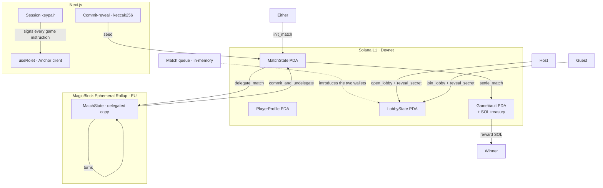

# ROLET

<p align="center">
  
  
  
  
  
</p>

<p align="center">
  <strong>Turn-based tactical chamber duel on Solana. Two wallets, one revolver, one vault.</strong><br/>
  Eight chambers. Twelve tactical cards. Turns settle on an ephemeral rollup.
</p>

<p align="center">
  <a href="https://github.com/SmtDcs/rolet">GitHub Repository</a> ·
  <a href="https://web-production-40a6c.up.railway.app">Live Demo (Devnet)</a> ·
  <a href="https://explorer.solana.com/address/mspQcUFhmAGYUsnBbcUndhaZiris53KtwYCjDHU91oH?cluster=devnet">On-chain Program (devnet)</a>
</p>

---

## What is it?

Two players share a revolver loaded with **5 live + 3 blank** rounds across 8 chambers. On each turn a player either plays a tactical card or pulls the trigger. First to 0 HP loses. The winner is paid a fixed SOL reward from an on-chain treasury PDA.

Twelve cards change the outcome: reveal the next chamber with **HawkEye**, eject it with **BulletExtractor**, shield the next shot with **Blocker**, deal double damage with **DoubleStrike**, and eight more.

Chambers, cards, hits and payouts are Solana instructions and account state. The only server-side part is the match queue, which introduces two wallets to each other and nothing else.

**One wallet prompt per player.** A single session transaction funds and registers an ephemeral key; every later step — opening the lobby, revealing, seeding the match, delegating, every turn, and settling — is signed by that key.

---

## How a match runs

```
Player A                                Player B
────────                                ────────
/profile  → take a character           /profile  → take a character
/duel     → FIND MATCH                  /duel     → FIND MATCH
  └─ each wallet signs one queue message
  └─ the server names one of them host
                            ▼
  session transaction (1 prompt): fund a fresh key + register_session_key
                            ▼
open_lobby(host_commit)  ───────────►   join_lobby(guest_commit)
  └─ burns 1 durability                   └─ burns 1 durability
reveal_secret ──────────────────────►   reveal_secret
  commit = keccak(secret ‖ player ‖ match_id)
                            ▼
init_match  →  seed = keccak(host_secret ‖ guest_secret ‖ future slot hash ‖ match_id)
delegate_match  →  MatchState moves to the MagicBlock ephemeral rollup (EU validator)
                            ▼
        turns execute on the rollup — no wallet prompts
        ├─ pull_trigger → chamber fires, HP damage
        ├─ play_card    → HawkEye, Blocker, DoubleStrike, …
        └─ next turn
                            ▼
commit_and_undelegate_match  →  state returns to L1
settle_match  →  fixed reward from the treasury PDA to the winner
sweepSession  →  the leftover SOL on the session key goes back to the wallet
```

`Player A` and `Player B` are interchangeable after the lobby opens; either seat can drive the match forward.

---

## Architecture



Why the rollup: turns are the hot path. Delegating `MatchState` puts them on a sub-second rollup, while the lobby, the character economy and the payout stay on L1 where the money lives. Only one account is delegated, on purpose.

---

## On-chain Instructions

| Instruction | Description |
|---|---|
| `set_character_nft` | Equip a validated Metaplex Core character on the profile (unpaid path) |
| `purchase_character` | Charge `character_price_sol`; split 5% ops / 95% treasury; equip the character |
| `register_session_key` | Store the ephemeral pubkey and its expiry on `PlayerProfile` |
| `open_lobby` | Host creates `LobbyState` with `host_commit`; burns 1 durability |
| `join_lobby` | Guest submits `guest_commit` only (no secret); burns 1 durability |
| `reveal_secret` | Either seat reveals a secret bound to its pubkey and `match_id` |
| `init_match` | After both reveals, seeds from a future slot hash and creates `MatchState` |
| `delegate_match` | Moves `MatchState` to the ephemeral rollup (owner becomes the delegation program) |
| `pull_trigger` | Fire the current chamber; apply HP damage |
| `play_card` | Resolve one of 12 tactical cards |
| `commit_and_undelegate_match` | Commits the rollup copy and returns `MatchState` to the program |
| `settle_match` | Pay the fixed `reward_sol` from the treasury PDA to the winner |
| `claim_timeout` | If the player to move stalls past `TURN_TIMEOUT_SLOTS`, the waiting player wins |
| `close_lobby` | Refund durability only before both reveals; after that, rent only |

**Signing model.** Every one of these takes the wallet as an unsigned `authority` (it seeds the PDAs and passes the participant checks) plus a `signer` that may be the wallet's registered session key. `init` pays rent from `signer`, so a funded session key covers lobby and match accounts. This is what turns a match from roughly ten wallet prompts into one.

---

## Economy

| Parameter | Value |
|---|---|
| Character price | free on devnet (0.1 SOL at launch); 10 durability, each match burns 1 |
| Purchase split | 5% ops wallet / 95% treasury |
| Match reward | fixed 0.02 SOL from the treasury PDA |
| Session funding | 0.02 SOL moved from the wallet into the session key, returned at the end |

No token. Winners are paid in SOL.

---

## Stack

| Layer | Tech |
|---|---|
| Program | Anchor 1.0.2 · Rust · Solana CLI 3.1.9 |
| Rollup | MagicBlock `ephemeral-rollups-sdk` 0.17.3 · EU devnet validator |
| Frontend | Next.js 16 · React 19 · Tailwind v4 |
| Client | `@coral-xyz/anchor` 0.32 · `@solana/web3.js` · session keypair |
| Character NFT | Metaplex Core (`@metaplex-foundation/mpl-core`) minted client-side |
| Wallet | Phantom / Solflare via Wallet Standard |
| Identity | Bonfida SNS |
| Queue | One Node process, in-memory — no database, no Redis |

---

## Quickstart

**Prerequisites:** Rust, Solana CLI 3.1.9, Anchor 1.0.2, Node 20+, pnpm

```bash
pnpm install

cp apps/web/.env.example apps/web/.env.local
# fill in:
#   NEXT_PUBLIC_RPC_ENDPOINT=/api/rpc            (the proxy route)
#   NEXT_PUBLIC_SOLANA_NETWORK=devnet
#   NEXT_PUBLIC_ROLET_PROGRAM_ID=mspQcUFhmAGYUsnBbcUndhaZiris53KtwYCjDHU91oH
#   NEXT_PUBLIC_MAGICBLOCK_ER_ENDPOINT=https://devnet-eu.magicblock.app
#   RPCFAST_BACKEND_URL=<your RPC provider's devnet URL>
#   RPCFAST_API_KEY=<your key>

cd apps/web
pnpm build && pnpm start --port 3001
```

Open `http://localhost:3001`, set the wallet to **Devnet**, and take a character at `/profile` before your first match. Devnet characters are free; the vault price is what gates them at launch.

Both players need a character and some devnet SOL. The queue lives in one Node process, so run a single instance — it will not work behind a platform that spreads requests across isolates.

### Build and deploy the program

```bash
cd apps/server
PATH="$HOME/.local/share/solana/install/releases/3.1.9/bin:$PATH" ~/.avm/bin/anchor-1.0.2 build

solana program deploy target/deploy/rolet.so \
  --program-id target/deploy/<your-keypair>.json \
  --keypair ~/.config/solana/id.json \
  --url https://api.devnet.solana.com
```

If the new binary is less than 10 KB larger than the deployed one, `solana program deploy` refuses and asks for a minimum extension; grow the account first:

```bash
solana program extend <PROGRAM_ID> 20480 --url https://api.devnet.solana.com
```

Bootstrap the vault once (`reward_sol`, `character_price_sol`, ops wallet, treasury), then fund the treasury PDA so rewards can be paid.

---

## Repo Layout

```
rolet/
├── apps/
│   ├── server/
│   │   ├── programs/rolet/src/lib.rs     # Anchor program
│   │   ├── Anchor.toml                   # toolchain: anchor 1.0.2, solana 3.1.9
│   │   ├── scripts/bootstrap-vault.ts    # one-time vault setup
│   │   └── target/idl/rolet.json         # generated IDL (copied into the web app)
│   └── web/
│       ├── app/                          # routes: /, /duel, /profile, /leaderboard
│       ├── app/api/rpc/route.ts          # RPC proxy, rate limited per IP
│       ├── app/api/matchmaking/route.ts  # the in-memory queue
│       ├── components/DuelRoom3D.tsx     # the chamber room: geometry, lights, display pass
│       ├── components/                   # landing sections, duel HUD, nav
│       ├── public/character/             # Core metadata + seat image
│       ├── public/sounds/                # match cues
│       ├── hooks/useRolet.ts             # Anchor client, session keys, all game calls
│       ├── lib/chainPace.ts              # pure rules (seat, launch gate, turns, limits)
│       ├── lib/chainPace.test.ts         # node:test unit suite
│       └── idl/rolet.json                # IDL the client loads
├── Dockerfile                            # single-replica image for Railway
└── railway.json                          # deploy config
```

---

## Tests

Pure game rules are unit-tested with `node:test`:

```bash
cd apps/web
../../apps/server/node_modules/.bin/tsx --test lib/chainPace.test.ts lib/seat.test.ts lib/matchQueue.test.ts
```

Covered: queue states, seat decisions, reveal gating, launch readiness, session funding and sweeping, RPC backoff, payout protection against a fresh match, and the rollup routing decision.

---

## Rendering

The duel is not a picture of a table. `DuelRoom3D.tsx` builds the room from flat-shaded primitives behind two barn-door reflectors, renders it into a 0.72× buffer, and passes the result through one display shader: ordered Bayer dither, posterise to seven levels, grain, vignette and a two-tone grade that lifts the shadows cold and leaves the highlights brass. Nothing in the room carries a photo texture on purpose — the banding and the grain are added, so surfaces cannot go mushy the way generated maps do.

---

## Known Limitations

- **The queue is one process.** It holds pairings in memory, so it must run as a single instance. A multi-instance host would split the queue across isolates; a shared store is the fix if this ever needs to scale horizontally.
- **`claim_timeout` is unusable while a match is delegated.** It compares the last action slot with the rollup clock, whose slot numbers are not base-layer slots. A timeout path for delegated matches needs its own accounting.
- **Session leftovers need the tab to stay open.** `sweepSession` returns the session key's remaining SOL to the wallet on a timer after the match ends. If the player closes the tab immediately, that key keeps its balance.
- **Character ownership is self-attested.** The program validates a Core asset by checking that its `update_authority` equals the program ID, and the client writes that field at mint time. A program-signed mint (CPI) or a program-owned Core collection check is the production fix.
- **Public devnet RPC throttles.** `api.devnet.solana.com` answers 429 under match traffic. The client now backs off and retries, but a dedicated devnet endpoint (`RPCFAST_BACKEND_URL`) is the real fix.
- **Devnet only.** The program, the vault and the characters live on devnet.

---

## License

MIT

## Asset Credits

- **Revolver, speed loader, cartridge case** — meshes generated with Meshy AI, retopologised to ~20k triangles each and rendered untextured: the look's grain comes from the display pass, not from maps.
- **The chamber room** — geometry written in `DuelRoom3D.tsx`: table, rails, reflector lamps, the operator's housing, and the marks painted on the baize.
- **Seat image** — made for this project.
- **Sound effects** — CC0/free-license sources bundled in `public/sounds/`.
