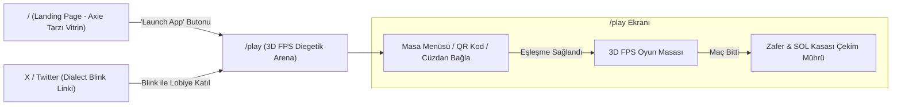

# ROLET — Occult Duel Chamber Landing & 3D Diegetic Game Portal Specification

**Tarih:** 2026-10-04  
**Durum:** Onaylandı / Uygulama Planı Aşamasında  
**Hedef Kitle:** Web3 oyuncuları, Solana hackathon jürileri, kripto fuarı & vitrin katılımcıları  
**Sözleşme (Solana Devnet):** `Gwh17ftx2mhKNV7BFgGXDYbtpxC1gw6gJbXEk3xYE792`

---

## 1. Vizyon ve Genel Hedefler

Bu şartname, **ROLET** projesini ham bir Web3 prototipinden, **Axie Infinity** kalibresinde profesyonel bir vitrine ve *Inscryption* esintili atmosferik bir **tamamen diegetik (oyun dünyasına yedirilmiş) 3D FPS düello oyununa** dönüştürme planını tanımlar.

### Temel Hedefler:
1. **İki Katmanlı Web Mimarisi:**
   * `/` (Landing Page): Cüzdansız da gezilebilen, 3D interaktif vitrinli, zengin hikâye, kurallar, kart galerisi ve on-chain ekonomi şeffaflığı sunan pazarlama sitesi.
   * `/play` (Oyun Portalı): "Launch App" butonuna basıldığında açılan, sıfır 2D UI kirliliği olan, 3D birinci şahıs (FPS) diegetik düello arenası.
2. **Occult Underground Duel Chamber (Okült Yeraltı Düello Salonu) Estetiği:**
   * Koyu maun ahşap, eskitme yeşil çuha (baize felt), pirinç detaylar, yanan balmumu şamdanlar ve altın varak mühürler.
3. **Diegetik 3D Arayüz (Zero 2D HUD):**
   * Ekranda yüzen can barı veya butonlar yok. Masadaki 4 yanan mum (can), pirinç mermi tepsisi, fiziksel tarot kartları ve elinizle tutup çevirdiğiniz 3D revolver.
4. **Meshy AI MCP 3D Varlık Üretimi:**
   * Özel 8-hazneli okült revolver, antika düello masası, pirinç şamdan ve maskeli rakip modellerinin Meshy AI MCP ile üretilip optimize edilmesi.
5. **Solana Hackathon & Fuar Çarpanları:**
   * **MagicBlock Ephemeral Rollups (ER):** Planlanan yol haritası — henüz aktif değil. Gazsız hamleler bugün Solana L1 üzerinde session key'lerle çalışıyor.
   * **Dialect Solana Blinks:** X / Twitter üzerinden tek tıkla doğrudan düelloya lobi açma / katılma.
   * **Metaplex Core NFT:** 10 Dayanıklılık (Durability) yaşam döngüsü ve %90 Hazine / %5 Sigorta / %5 Ops gelir bölüşümü.
   * **Bonfida SNS:** Masadaki pirinç plakada kazınmış doğrulanmış `.sol` kimliği.

---

## 2. Görsel Kimlik ve Tasarım Sistemi

### Renk Paleti (Sanat & Düello Salonu Yönü)
| Renk Kodu | İsim | Kullanım Alanı |
|---|---|---|
| `#0B0907` | Zifiri Obsidiyen | Sayfa arka planı, derin gölgeler |
| `#1E1611` | Koyu Maun | Ahşap masa dokuları, kart çerçeveleri |
| `#152B1E` | Düello Çuhası | Masa yüzeyi, yeşil vurgular, güvenli durumlar |
| `#C6A15B` | Parlatılmış Pirinç / Altın Varak | Butonlar, başlıklar, aktif kart ışıltıları, sayaçlar |
| `#8C2727` | Kuru Kan / Bordo | Hasar, canlı mermi, uyarılar ve tehlike |
| `#E6D7C3` | Eskitme Parşömen | Tarot kart gövdeleri, okunabilir metinler |

### Tipografi
* **Display / Başlıklar:** `Cinzel` / `Cinzel Decorative` (Google Fonts). Mühür, klasik düello salonu ve okült kitabe hissi.
* **Açıklama / Metin Gövdesi:** `Space Mono` ve `Cinzel` kombinasyonu (Modern on-chain veriler ile antika atmosfer dengesi).

---

## 3. Sayfa Yapısı ve Kullanıcı Akışı

---

## 4. Bölüm Bölüm Landing Page Şartnamesi (`/`)

### 4.1. Header (Navigasyon Çubuğu)
* **Sol:** Altın damgalı revolver silindiri logosu ve **ROLET** marka yazısı.
* **Orta:** 
  * `[Masa Kuralları]` (Sayfa içi `#rules` bağlantısı)
  * `[Kart Destesi]` (Sayfa içi `#grimoire` bağlantısı)
  * `[Kasa Ekonomisi]` (Sayfa içi `#economy` bağlantısı)
  * `[Liderlik Kürsüsü]` (Sayfa içi `#leaderboard` bağlantısı)
  * `[Dokümanlar]` (GitBook / Teknik rehber bağlantısı)
* **Sağ:** 
  * Solana Devnet Rozeti (Pulsing yeşil LED)
  * Altın varak ışıltılı **[LAUNCH APP]** butonu (`/play` rotasına yönlendirir).

### 4.2. Hero Bölümü (3D İnteraktif Merkez)
* **Başlık:** *"SEKİZ HAZNE. ON İKİ KART. KAZANAN TÜM KASAYI ALIR."*
* **Alt Metin:** *"Solana L1 üzerinde çalışan, sıfır sunucu ve hilesiz commit-reveal rastgeleliğine sahip ilk tamamen on-chain taktiksel hazne düellosu."*
* **3D Sahne:** 
  * Three.js Canvas: Kullanıcının faresiyle hafifçe döndürebileceği, ışık yansımalı okült işlemeli 3D revolver ve yanında süzülen 3D tarot kartları.
* **Aksiyonlar:**
  * **[ARENAYA GİR / LAUNCH APP]** (Büyük parlayan buton)
  * **[NASIL OYNANIR?]** (Kısa kural videosu / modal penceresi)
* **Canlı On-Chain İstatistik Ticker'ı:**
  * **Kasadaki Ödül:** Anlık `GameVault` bakiyesi (SOL)
  * **Sonuçlanan Düellolar:** Anlık `matches_settled` sayısı
  * **Hamle İmzalama:** Session key ile gazsız; MagicBlock ER planlanan yol haritasında

### 4.3. "The Rules of the Table" (Nasıl Oynanır)
3 kartlık şık bir storyboard döngüsü:
1. **1. Karakterini Masaya Sür:** Metaplex Core NFT ile otur, 10 dayanıklılığın her maçta 1'ini yak.
2. **2. Tetiği Çek veya Kart Oyna:** 5 canlı + 3 kuru mermi. Kuru mermide sıra sende kalır; canlı mermide can iner.
3. **3. Kasadaki SOL'u Cüzdanına Çek:** Canı 0'a inen elenir; kazanan PDA hazinesinden ödülü anında tahsil eder.

### 4.4. "The Grimoire" (12 Taktiksel Kart Galerisi - Axie Stili)
* Yatayda kaydırılabilir veya filtrelenebilir 12 tarot kartı:
  * `HawkEye` (Hazneyi röntgenle)
  * `BulletExtractor` (Sıradaki mermiyi dışarı fırlat)
  * `Blocker` (Gelecek hasarı kalkanla)
  * `DoubleStrike` (Sıradaki mermiyi 2 hasar yap)
  * `Healer` (+1 HP iyileş)
  * `RestoreBullet` (Boş hazneyi canlı mermiyle doldur)
  * `Shuffler` (Kalan hazneleri yeniden karıştır)
  * `CardThief` (Rakibin kartını çal)
  * `RandomInsight` (Rastgele bir haznenin mermisini öğren)
  * `LastChance` (Sadece 1 HP kaldığında rakibin sırasını atlat)
  * `HandOfFate` (Sıradaki mermiyi yazı-tura ile değiştir)
  * `Silence` (Rakibin bir sonraki tur kart oynamasını kilitle)
* **Kart İnteraksiyonu:** Fare üzerine geldiğinde kart 3D perspektifle açılanır, altın mührü parlar ve on-chain strateji ipuçları açılır.

### 4.5. Ekonomi & Provably Fair Güvencesi (90 / 5 / 5 Modeli)
* **Sürdürülebilir Gelir Bölüşümü:** Karakter alımlarından toplanan SOL'un dağılımı:
  * **%90 Hazine (Treasury / Kazanan Ödül Havuzu):** Her düelloda kazanan oyuncuya doğrudan SOL olarak dağıtılır. Oyuncu riske ettiği tutarın neredeyse iki katını (+%80 net getiri) kazanır.
  * **%5 Sigorta Fonu (Insurance / Safety Fund):** Olası uyuşmazlıklar ve ağ kesintisi tazminatları için ayrılan koruma rezervi.
  * **%5 Geliştirme & Operasyon (Ops Wallet):** Protokol bakımı, altyapı ve RPC maliyetleri.
* **Commit-Reveal Hilesizlik Güvencesi:** Host ve Guest tohumlarının `keccak256` ile kilitlenip manipüle edilemez RNG ürettiğinin basit şematik anlatımı (Host'un tohumu önceden görmesini engelleyen güvenli taahhüt protokolü).
* **Masa Güvencesi:** Lobi açıp iptal eden (`close_lobby`) oyuncunun dayanıklılığı (durability) eksiksiz iade edilir.

### 4.6. Liderlik Kürsüsü & Footer
* En çok kazanan `.sol` (Bonfida SNS) sahipleri listesi.
* Footer: GitHub, X/Twitter, Discord, Solana ekosistem rozeti ve ambient retro ses açma/kapama ikonu.

---

## 5. 3D FPS Diegetik Oyun Arenası Şartnamesi (`/play`)

### 5.1. Kamera ve Atmosfer
* **Kamera:** Oyuncunun gözünden masaya bakan sabit/hafif nefes alan FPS kamerası.
* **Aydınlatma:** Masanın tam ortasını aydınlatan tek bir sıcak mum/pirinç lamba hüzmesi, etrafı koyu chiaroscuro gölgeler.
* **Karşı Taraf:** Ahşap sandalyede oturan, yüzünde porselen Venedik maskesi olan gizemli rakip düellocu figürü.

### 5.2. Diegetik Masa Objeleri (Sıfır 2D HUD)
1. **Can Göstergesi (HP):**
   * Masanın solunuzda duran antika pirinç tepside **4 yanan kalın balmumu mum**. Hasar alındığında mum puf sesiyle söner ve dumanı tüter (rakibin önünde de 4 mum durur).
2. **Hazne & Mermi Tepsisi:**
   * Masanın sağında ahşap/pirinç bölmeli tepsi: 5 altın uçlu canlı mermi, 3 boş pirinç kovan. Fırlatılan veya sıkılan mermiler bu tepsiye tıkırdar.
3. **Sıra Göstergesi:**
   * Sıra sizdeyken masanın ortasındaki antika altın sikke önünüze doğru kayar; sıra rakipteyken karşıya kayar.
4. **Tetik Etkileşimi:**
   * Masanın ortasında duran revolvera fareyle tıklandığında oyuncunun eli silahı kavrar.
   * Silahı hafifçe kendinize çevirip tıklarsanız namlu ekrana bakar (Kendine Ateş).
   * Rakibe doğrultup tıklarsanız namlu karşıya kilitlenir (Rakibe Ateş).
5. **Kart Destesi:**
   * Elinizdeki 4 taktiksel kart masanın alt ahşap pervazında hafifçe yelpaze şeklinde dizilidir. Tıklanan kart masanın ortasına doğru süzülür ve alev alarak etkisini icra eder.
6. **Oyuncu Kimliği Plakası:**
   * Masanın kenarına çakılmış küçük pirinç plaka üzerinde Bonfida SNS `.sol` adınız (örn: `samet.sol`) altın kabartma olarak okunur.

---

## 6. Meshy AI MCP 3D Varlık Üretim Planı

Meshy MCP araçları (`meshy_text_to_3d`, `meshy_download_model`) ile `apps/web/public/models/` dizinine üretilecek varlıklar:

| Dosya Adı | Meshy AI Promptu | Kullanım Alanı |
|---|---|---|
| `revolver_occult.glb` | *"Antique heavy 8-chamber Western occult revolver, dark gunmetal cylinder, intricate polished brass engravings, PBR, game ready"* | Hero 3D sahnesi + Oyun içi silah |
| `arena_table.glb` | *"Antique dark mahogany circular duel table with worn green velvet baize top, brass corner inlays, Victorian style, game asset"* | FPS oyun masası |
| `bullet_cartridges.glb` | *"Vintage brass revolver bullet cartridge, live round with copper tip, blank spent casing, photorealistic"* | Masa mermi tepsisi |
| `candelabra_props.glb` | *"Ornate antique brass candelabra with melting wax candles, vintage poker chip stack"* | Masa aydınlatması & can göstergesi |
| `opponent_duelist.glb` | *"Dark Victorian masked duelist wearing formal frock coat, seated pose, sinister porcelain mask, occult undertones"* | Karşıdaki rakip oyuncu |

---

## 7. Solana Hackathon & Web3 Entegrasyonları

### 7.1. MagicBlock Ephemeral Rollups (ER) — Planlanan, Henüz Aktif Değil
* Hedef tasarım: lobi kapandığında `MatchState` hesabının MagicBlock ER'ye delege edilmesi.
* ER yolu şu an devre dışı (Rust SDK bağımlılık çatışması — bkz. README Known Limitations). Maçlar Solana L1 üzerinde çalışır; gazsız hamleler session key'lerle bugün de mümkündür.
* ER yolu açıldığında maç sonucu Solana L1'e commit edilecek ve kazanan ödülünü alacak.

### 7.2. Dialect Solana Blinks / Actions
* Lobi oluşturulduğunda tek tıkla üretilen Blink URL'si (`https://.../api/actions/duel?lobby=<id>`):
* X / Twitter'da paylaşıldığında doğrudan tweet akışı içinde interaktif bir "Düelloya Katıl" butonuna dönüşür.

### 7.3. Metaplex Core & Bonfida SNS
* Metaplex Core AssetV1 formatında Karakter NFT'si, 10 Dayanıklılık (durability) tüketimi ve %90 Hazine / %5 Sigorta / %5 Ops kontrat split'i.
* Bonfida SNS ile doğrulanmış `.sol` alan adının masadaki diegetik pirinç plakada gösterilmesi.

---

## 8. Doğrulama ve Kabul Kriterleri (Done Criteria)

1. **Görsel & Vitrin:**
   * `/` sayfası Axie tarzı modern düzende, kesintisiz 60 FPS Three.js hero sahnesiyle açılmalı.
   * 12 kartlık Grimoire galerisi interaktif olarak incelenebilmeli.
   * Canlı kasa istatistikleri doğrudan `GameVault` PDA'sından okunmalı.
2. **"Launch App" & Portalı:**
   * "Launch App" butonuna basıldığında `/play` rotasına geçilmeli.
   * Lobi oluşturulduğunda masa başı **QR Kod** anında ekranda belirmeli.
3. **Diegetik 3D Oynanış:**
   * Oyun içinde hiçbir 2D can barı olmamalı; masadaki mumlar ve mermi tepsisi durumu yansıtmalı.
   * Meshy AI modelleri Three.js sahnesinde PBR dokularla kusursuz görünmeli.
4. **On-Chain & Web3:**
   * Session Key kaydıyla maç boyu sıfır Phantom popup'ı ile oynanabilmeli.
   * Dialect Action / Blink uç noktası Twitter paylaşımına hazır olmalı.
